# Panel Types

A panel is one screen on the display. There are **14 panel types** you can add, plus built-in popups and system panels. The **Add panel** catalog groups the types under **Backgrounds**, **Entities**, **Grouping** and **Tools**, and also lists **Extend a popup** and **Copy an existing panel**. Select a panel below to read what it shows and which options it has.

You add panels in the editor, see the [Editor overview](../editor/README.md). The [Screens overview](../screens.md) shows every panel in the landscape and the portrait layout.

## Backgrounds

Full-screen panels without header buttons. They work well as the home panel or as the idle panel.

| Preview | Panel | Type | Shows |
|---------|-------|------|-------|
| <a href="panel_weather.md">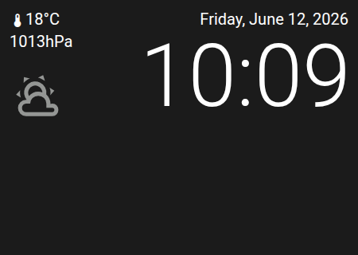</a> | [Weather](panel_weather.md) | `weather` | Current weather, a forecast, the time and up to two extra values |
| <a href="panel_clock.md">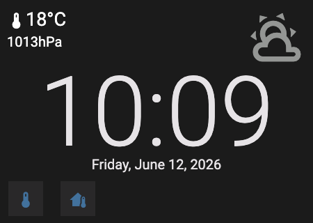</a> | [Clock](panel_clock.md) | `clock` | A large time and date, optional weather and up to six buttons |
| <a href="panel_clocktwo.md">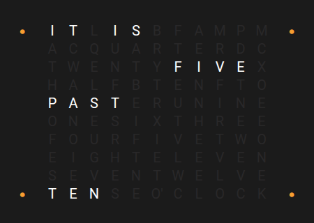</a> | [ClockTwo](panel_clocktwo.md) | `clocktwo` | The time in words, for example "IT IS HALF PAST TWELVE" |

## Grouping

Panels that show and control several entities at once.

| Preview | Panel | Type | Shows |
|---------|-------|------|-------|
| <a href="panel_grid.md">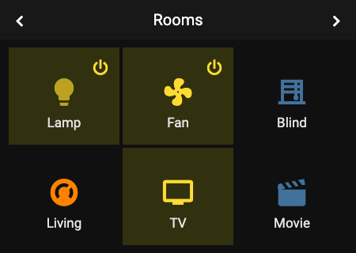</a> | [Grid](panel_grid.md) | `grid` | Six tiles per page, each with an icon and a name |
| <a href="panel_row.md">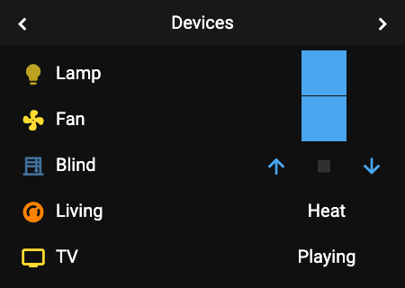</a> | [Row](panel_row.md) | `row` | Five rows per page, each with a control that fits the entity: toggle, slider, buttons or a value |

## Entities

Panels that control a single entity in full.

| Preview | Panel | Type | Controls |
|---------|-------|------|----------|
| <a href="panel_light.md">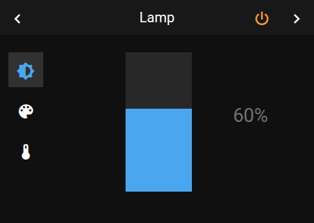</a> | [Light](panel_light.md) | `light` | Brightness, color temperature, color and effects |
| <a href="panel_media.md">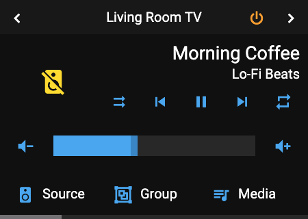</a> | [Media](panel_media.md) | `media` | Playback, volume, sources and speaker groups of a media player |
| <a href="panel_vacuum.md">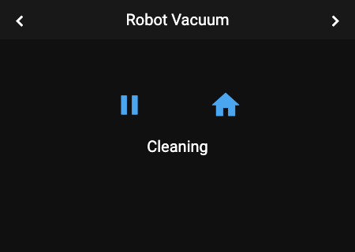</a> | [Vacuum](panel_vacuum.md) | `vacuum` | Start, stop, return to dock, fan speed and locate |
| <a href="panel_cover.md">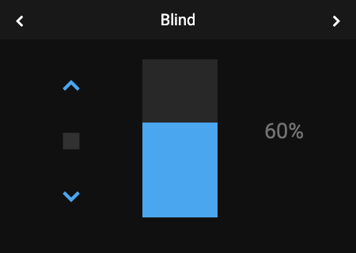</a> | [Cover](panel_cover.md) | `cover` | Open, stop, close and a position slider |
| <a href="panel_climate.md">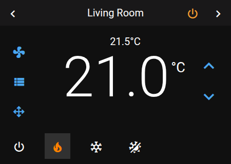</a> | [Climate](panel_climate.md) | `climate` | Target temperature, modes, fan, swing and presets |
| <a href="panel_camera.md">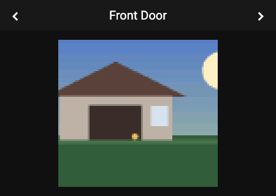</a> | [Camera](panel_camera.md) | `camera` | One camera's picture, refreshed on the display |

## Tools

Panels for special tasks.

| Preview | Panel | Type | Shows |
|---------|-------|------|-------|
| <a href="panel_timer.md">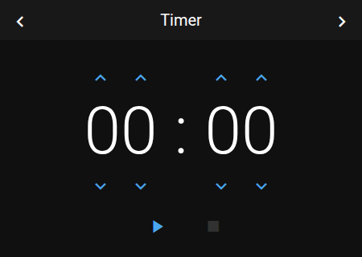</a> | [Timer](panel_timer.md) | `timer` | A countdown timer or stopwatch. Needs no entity. |
| <a href="panel_qr.md">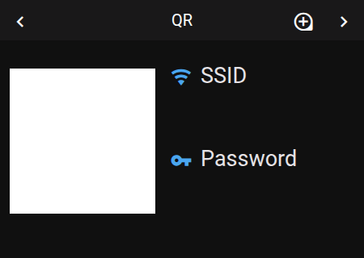</a> | [QR Code](panel_qr.md) | `qr` | A QR code for your Wi-Fi |
|  | [Alarm](panel_alarm.md) | `alarm` | A keypad to arm and disarm an alarm system |

## Popups

Popups open on top of the current panel and close again. They are built in; you do not add them.

| Preview | Popup | Key | Opens when |
|---------|-------|-----|------------|
| <a href="popup_notify.md">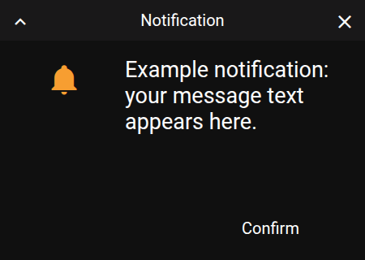</a> | [Notify](popup_notify.md) | `popup_notify` | A notification is shown |
| <a href="popup_select.md">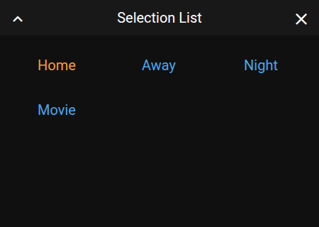</a> | [Select](popup_select.md) | `popup_select` | You choose from a list, for example a fan speed or a preset |
| <a href="popup_unlock.md">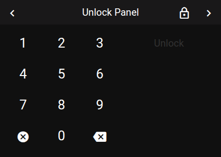</a> | [Unlock](popup_unlock.md) | `popup_unlock` | You open a panel that has a PIN |

These popups show one item's full controls in the panel of its type. Tapping a light, media player, vacuum, cover, climate or alarm entity on a grid, row or other panel opens its popup; a timer item opens the timer popup.

| Preview | Popup | Key | Controls |
|---------|-------|-----|----------|
| <a href="panel_light.md">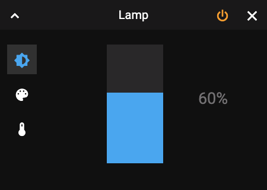</a> | Light | `popup_light` | The [Light](panel_light.md) panel |
| <a href="panel_media.md">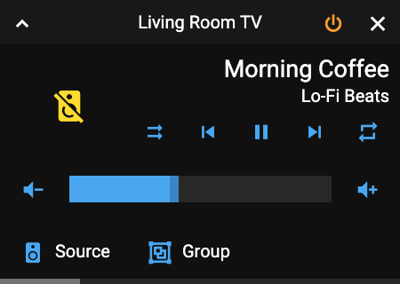</a> | Media player | `popup_media_player` | The [Media](panel_media.md) panel |
| <a href="panel_vacuum.md">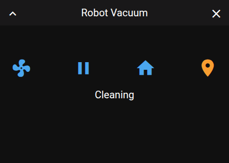</a> | Vacuum | `popup_vacuum` | The [Vacuum](panel_vacuum.md) panel |
|  | Cover | `popup_cover` | The [Cover](panel_cover.md) panel |
| <a href="panel_climate.md">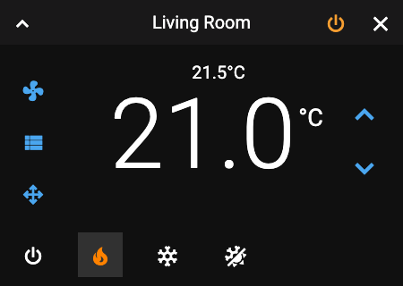</a> | Climate | `popup_climate` | The [Climate](panel_climate.md) panel |
| <a href="panel_alarm.md">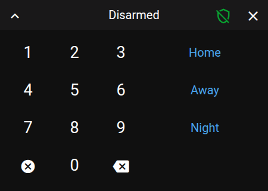</a> | Alarm | `popup_alarm` | The [Alarm](panel_alarm.md) panel |
| <a href="panel_timer.md">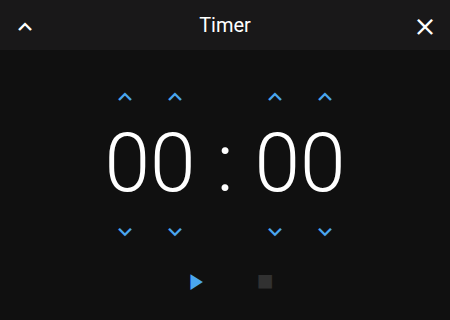</a> | Timer | `popup_timer` | The [Timer](panel_timer.md) panel |

You can change a popup for a device with **Add panel → Extend a popup**, see [System Panel Overrides](../editor/panels.md#system-panel-overrides). To open one of your own panels on top of another panel, see [Stacked Panels and Popups](../editor/panels.md#stacked-panels-and-popups).

## System Panels

Always there. They need no configuration and cannot be changed.

| Preview | Panel | Key | Shows |
|---------|-------|-----|-------|
| <a href="panel_blank.md">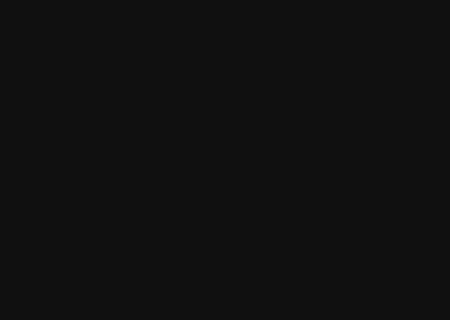</a> | [Blank](panel_blank.md) | `sys_blank` | Nothing. Add it to the idle panels for an empty screen. |
| <a href="panel_system.md">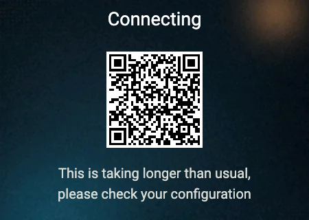</a> | [System](panel_system.md) | `sys_system` | A message while the panel connects or has lost its connection |
| <a href="panel_settings.md">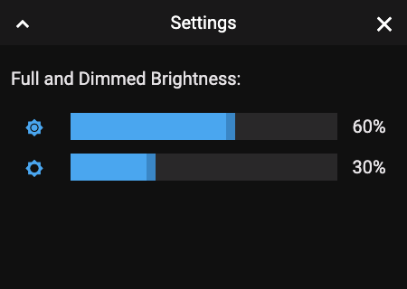</a> | [Settings](panel_settings.md) | `sys_settings` | Brightness sliders. Swipe down to open it. |
| <a href="panel_about.md">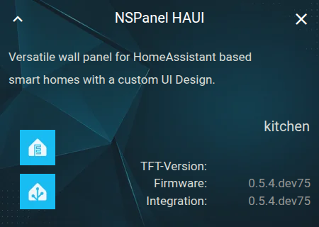</a> | [About](panel_about.md) | `sys_about` | Versions and the IP address. Swipe up to open it. |
