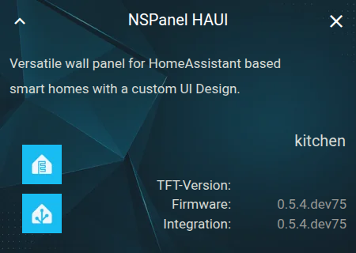
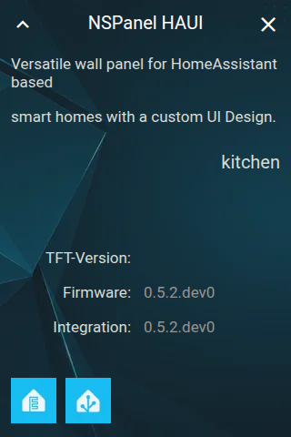

# Panel About

 

The About panel shows the device name, its IP address and three distinct versions:

- **Display (TFT)** — the version of the file installed on the screen
- **Firmware (YAML)** — the ESPHome build version reported by `yaml_version`
- **Integration** — the Home Assistant integration version from `manifest.json`

Swipe up from the bottom edge of the screen to open it.

This is a built-in panel. You cannot add or change it.
