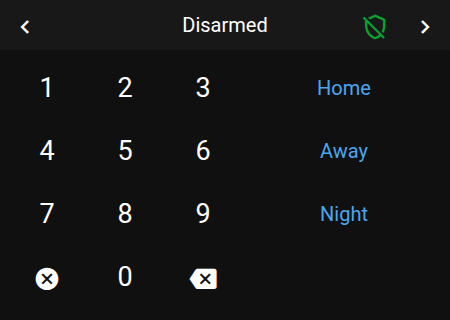
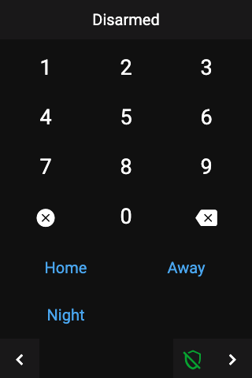

# Panel Alarm

 

## About

The alarm panel arms and disarms an alarm system (an `alarm_control_panel` entity). It has a keypad for the code and up to 4 buttons for the arm modes.

## How to configure

| Option | Description |
|--------|-------------|
| **Item** | The `alarm_control_panel` entity. Required. |
| **Keypad font size** | Font of the keypad, 0–7. Default `2`. |
| **Keypad button background**, **Keypad text color** | Your own keypad colors. Empty: the selected theme. |
| **Hidden arm modes** | Arm modes that are not offered, even if the entity supports them. |
| **Show action icons** | Show an icon in front of each action when there is room. |
| Arm and disarm button colors | Your own text and background colors for the action buttons. Empty: the selected theme. |

## What it shows

| Part | Description |
|------|-------------|
| **Title** | The alarm state, for example "Disarmed", "Armed Home" or "Triggered". While you type a code, it shows dots instead. |
| **Shield icon** | In the header: red when armed, green when disarmed, amber while arming or pending. |
| **Keypad** | The digits 0–9, **CLR** (clear everything) and **DEL** (delete the last digit). |
| **Action buttons** | **Disarmed** (or the state is unknown): up to 4 arm modes, in this order: Home, Away, Night, Vacation, Bypass. Only modes the entity supports are shown; if it reports none, Home, Away and Night are offered. **Any other state:** one **Disarm** button. |

## Entering a code

- If the entity uses a code, the code is needed to disarm. It is also needed to arm, unless the entity says otherwise.
- Pressing an action without the needed code does nothing. What you typed so far is kept.
- After an action, or when the alarm state changes, the typed code is cleared.

## Popup

Tapping an alarm entity on another panel, for example a tile on a grid, opens the same keypad as a popup (`popup_alarm`).
