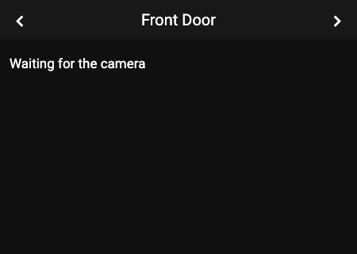
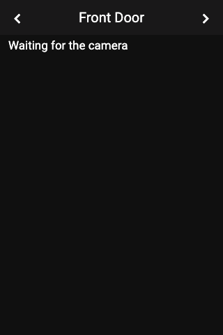

# Panel Camera

 

## About

The camera panel shows one camera's picture and keeps it current: the hub fetches a snapshot a few times a second and paints only what changed on the display, so a still scene costs nothing and a person walking through the frame costs a handful of small rectangles per update.

It is a picture, not a video. The display has no image buffer and no video path, so the panel can afford a couple of snapshots a second on a camera that is mostly still. A camera that pans or a scene that moves everywhere will look like a slow slideshow — for those, a page background picture or [`nspanel_haui.show_image`](../actions.md#images-on-the-panel) is the better fit.

The panel uses the display's **info page**: its text area becomes the picture area, and the six buttons below it stay empty.

## How to configure

| Option | Default | Description |
|--------|---------|-------------|
| **Camera** | | The camera entity whose picture the panel shows. Required. |
| **Frames per second** | 2 | How often a snapshot is fetched, from 0.1 to 10. Two keeps a still picture current; more only helps on a camera that moves. |

## How it behaves

- **The picture starts after the page is up.** Until the first snapshot arrives the panel shows *Waiting for the camera*; a panel without a camera entity shows *No camera selected* and never fetches one.
- **Only what changed is painted.** The hub compares each snapshot with what the display is showing; a scene that has not changed sends no display commands at all.
- **Each update takes as long as it takes.** A frame that arrives while the display is still painting the previous one is dropped rather than queued, so the panel always shows the newest picture it could paint instead of falling behind.
- **Detail adapts.** When a frame would cost too many rectangles — a scene in motion, a detailed picture — the hub repaints it in larger cells, then refines again once the picture calms down.
- **Leaving the page ends the stream.** So do a display that switches off, a TFT install, and a camera that stops answering. Nothing keeps running in the background.
- **The page returns to the idle page** like any other panel, which ends the stream.
- **Re-rendering restarts the picture.** A panel that re-renders (a refresh from the editor, for example) repaints its background; the stream starts over with a full frame instead of leaving half the area blank.

The picture is drawn over the page, so the stream ends the moment any other panel opens on top of it — a notification popup included — and it starts again when the camera page is shown again. Closing a popup therefore brings the picture back with a full frame.
