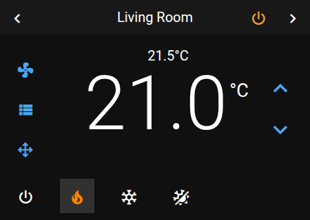
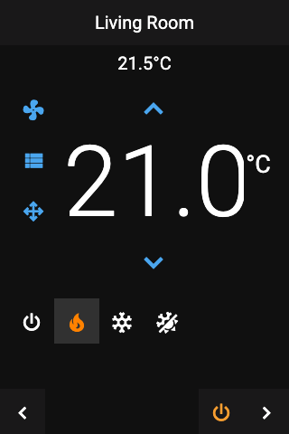

# Panel Climate

 

## About

The climate panel controls one thermostat, heating or air conditioner: the target temperature, the mode, and the fan, swing and preset settings.

## How to configure

| Option | Description |
|--------|-------------|
| **Item** | The climate entity to control. Required. |
| **HVAC modes** | Which modes are shown, and in which order: Off, Heat, Cool, Heat/Cool, Auto, Dry, Fan Only. Modes the entity does not support are left out. Not set: all modes the entity supports. |

## Controls

| Control | Description |
|---------|-------------|
| **Temperature** | The current temperature in large digits, in Home Assistant's unit (°C or °F). |
| **Up / down** | Change the target temperature by one step. The step comes from the entity; without one it is 0.5 (1 for °F). |
| **Low / high** | Two target temperatures with their own up and down buttons. Shown when the entity uses a temperature range, for example in Heat/Cool mode. |
| **Mode row** | Up to 6 mode icons at the bottom, for example heat, cool, auto. Tap one to change the mode. |
| **Power off** | A button in the header that turns the entity off. Shown while it is on. |
| **Fan**, **Swing**, **Preset** | Each opens a list to choose from. A button is greyed out when the entity does not support it. |

## How it behaves

- **Title:** the entity's name.
- **One or two target temperatures:** the panel shows what the current mode uses and switches when the mode changes, like Home Assistant's own thermostat card.
- **Limits:** the target temperature stays within the entity's minimum and maximum, and the low value never goes above the high value.
- **Colors:** the mode icons use fixed colors for a dark or a light background, chosen by the device's **Default icon color variant** in the Theme sidebar. They cannot be changed one by one.

## Popup

Tapping a climate entity on another panel opens the same controls as a popup (`popup_climate`).
