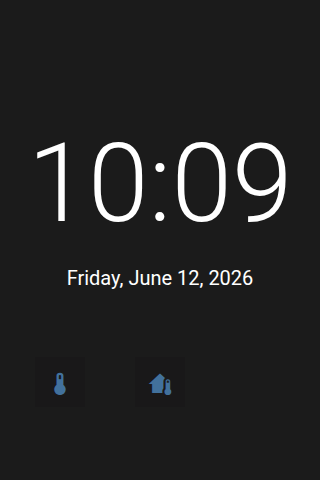

# Panel Clock

 

## About

The clock panel shows the time and date in large letters. It can also show the weather and up to 6 buttons for quick actions. It works well as a screensaver.

## How to configure

| Option | Default | Description |
|--------|---------|-------------|
| **Item** | — | A weather entity. Optional; needed for the weather options below. |
| **Background** | | A picture or **Use color scheme**, see [Background](#background). |
| **Show weather** | On | Show the weather icon. |
| **Show temperature** | On | Show the temperature and air pressure. |
| **Show home temperature** | Off | Show the inside temperature next to the weather. |
| **Inside temperature sensor** | Built-in sensor | The sensor for the inside temperature. Empty: the NSPanel's built-in temperature sensor. |
| **Weather icon color** | Color | **Color** colors the icon by condition, **Monochrome** uses the text color. |
| **Items** | — | Up to 6 entities shown as buttons at the bottom. |
| **Show notifications** | | Show the notification bell. |

### Cycle Cards

The time area can switch between several cards: the time, the date, temperatures and values of your entities. Each card is shown for a few seconds; the first card stays a little longer before the round starts again. **Tap the time area** to skip to the next card.

Only the time card is on by default, so nothing changes until you turn on another card.

| Option | Default | Description |
|--------|---------|-------------|
| **Show time** | On | The time with the date below it |
| **Show date** | Off | A separate date card: weekday and day (for example "Mon 16") with the full date below |
| **Show outside temperature** | Off | The temperature of the weather entity. Skipped when the panel has no weather entity. |
| **Show inside temperature** | Off | The inside temperature, from the **Inside temperature sensor** |
| **Card entities** | — | Up to 4 entities as extra cards: the value in large letters, the entity's name below. Change them with the item's **Name** and **Value** fields. |
| **Seconds per card** | 5 | How long each card is shown |
| **First card pause** | 15 | How long the first card stays after a full round, in seconds |

Good to know:

- The time card always shows the date below the time. **Show date** adds a *separate* date card.
- With no card turned on, the time card is shown.
- **Cards always fit.** A value that is too wide is shortened step by step: a 12-hour time loses AM/PM, `21°C` becomes `21°`, `21.456 °C` becomes `21.5°C` and then `21°C`. If that is not enough, a smaller font is used. Only a value that is too wide even for the smallest font is cut and ends in `..`.
- **Cards stay up to date.** The card on screen is drawn again as soon as its value changes.

### Background

Choose a picture, or **Use color scheme** for a plain background from the selected theme. Text and icons always use colors that are readable on the chosen background.

For a background that changes, for example at night, choose **Template…**. See [Background pages](../configuration/device.md#background-pages) for all backgrounds and an example.

### Leaving the Panel

This panel has no header buttons. To leave it:

- Swipe left or right from a screen edge to change the panel.
- Or turn on **Long press to go back** in the *Advanced* section. Then holding a finger anywhere for about a second goes back to the previous panel, or to the home panel. See [Standard Fields](../configuration/panels.md#standard-fields).
