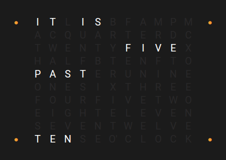
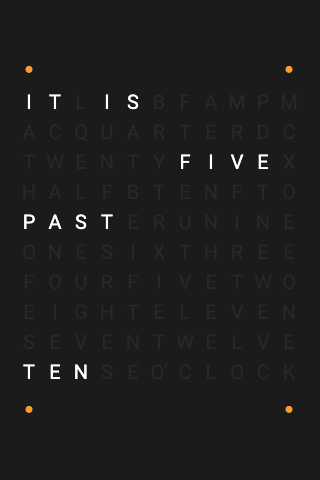

# Panel ClockTwo

 

## About

The ClockTwo panel is a word clock. It shows a grid of letters and lights up the words that spell the time, for example "IT IS HALF PAST TWELVE". The time is rounded to 5 minutes; four dots show the extra minutes.

## How to configure

| Option | Default | Description |
|--------|---------|-------------|
| **Background** | | A picture or **Use color scheme**, see [Background](#background). |
| **Clock language** | English | English, German or Polish. |
| **Show AM/PM** | Off | Show AM or PM. English only. |
| **Show intro text** | On | Always show the intro words ("IT IS"). |
| **Show intro text on full hour** | Off | Show the intro words on full hours. |
| **Off-letter color**, **Active letter color**, **Special letter color** | empty | Your own colors for the letters. Empty: the colors of the background or the selected theme. |
| **Show notifications** | | Show the notification bell. |

### Background

Choose a picture, or **Use color scheme** for a plain background from the selected theme. The letters and dots always use colors that are readable on the chosen background, unless you set your own letter colors.

For a background that changes, for example at night, choose **Template…**. See [Background pages](../configuration/device.md#background-pages) for all backgrounds and an example.

### Leaving the Panel

This panel has no header buttons. To leave it:

- Swipe left or right from a screen edge to change the panel.
- Or turn on **Long press to go back** in the *Advanced* section. Then holding a finger anywhere for about a second goes back to the previous panel, or to the home panel. See [Standard Fields](../configuration/panels.md#standard-fields).
