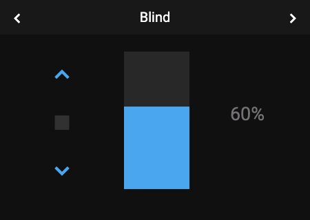
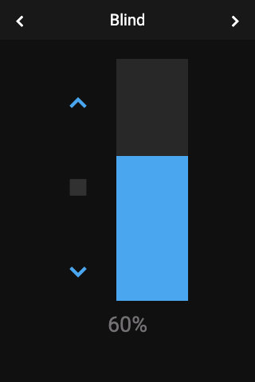

# Panel Cover

 

## About

The cover panel controls one cover, such as a blind, a curtain or a garage door. It has buttons to open, stop and close, and a slider for the position. It only shows the controls the cover supports.

## How to configure

| Option | Description |
|--------|-------------|
| **Item** | The cover to control. Required. |

## Controls

| Control | Description | Shown when |
|---------|-------------|------------|
| **Up** | Opens the cover. Inactive when it is fully open. | The cover can open |
| **Stop** | Stops the cover. Active only while it moves. | The cover can stop |
| **Down** | Closes the cover. Inactive when it is fully closed. | The cover can close |
| **Position slider** | Sets the position from 0 to 100 %. The current position is shown above it. | The cover can be set to a position |

## How it behaves

- **Title:** the cover's name.
- **Position:** shown as a percentage, for example `42%`. A cover that reports no position shows its state instead, for example `Open`.

## Popup

Tapping a cover on another panel opens the same controls as a popup (`popup_cover`).
