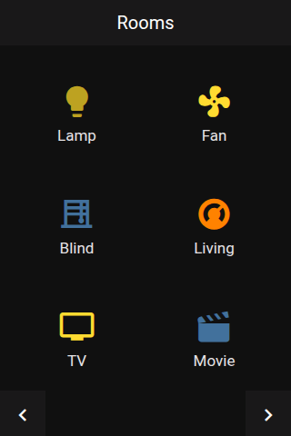

# Panel Grid

 

## About

The grid panel shows your entities as large tiles, six per page. Each tile has a name and an icon whose color follows the entity's state. It is a good first panel for lights, switches, sensors and scenes.

## How to configure

Add the entities you want as **items**. For each item you can change the name, icon and color, see [Item Configuration](../configuration/items.md).

### Colors

The tiles use the colors of the device's selected theme. You can set your own colors for:

- the tile's text and icon
- the tile's background
- the text and background while a tile is pressed
- the power button

Set only the colors you want to change; the others keep following the selected theme. An item's own **Color** changes the icon of that entity only.

To remove saved colors again, open the **Theme** sidebar and clear the panel and item color overrides.

## How it behaves

- **Tapping a tile** opens the popup for the entity, for example the light popup for a light. Entities without a popup are toggled or pressed.
- **More than 6 items:** a next-page button appears in the header.
- The panel remembers the page you were on and opens it again next time.
- A name that is too long for its tile is cut and ends in `..`.
