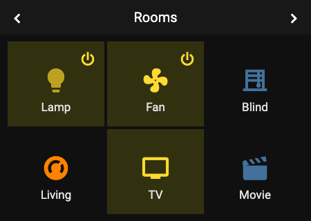
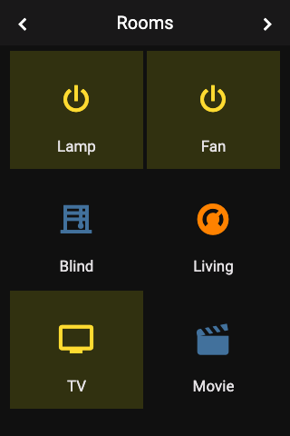

# Panel Grid

 

## About

The grid panel shows your entities as large tiles, six per page. Each tile has a name and an icon whose color follows the entity's state. It is a good first panel for lights, switches, sensors and scenes.

## How to configure

Add the entities you want as **items**. For each item you can change the name, icon and color, see [Items](../editor/items.md).

### Colors

The tiles use the colors of the device's selected theme: an off tile stays flat on the page, and an on tile lifts off it in the theme's on color. Each item can set its own tile colors in the **Advanced** section of its editor:

| Field | Colors |
|-------|--------|
| **Text color** | the tile's text and icon |
| **Background color** | the tile's background |
| **Pressed text color**, **Pressed background color** | the text and background while the tile is pressed |
| **Power button color** | the power button while the item is on, the theme's on color by default |
| **Show power button** | shows a power button that turns the item on or off; a domain without on or off — a scene, script, button, lock, vacuum or input select — runs that domain's own action instead |

Set only the colors you want to change; the others keep following the selected theme. Like the item's own **Color**, which changes the icon only, each tile color can be one color or one color per state, see [Values that depend on the state](../editor/items.md#values-that-depend-on-the-state).

To remove a color again, clear its field: the tile follows the theme again.

## How it behaves

- **Tapping a tile** opens the popup for the entity, for example the light popup for a light. Entities without a popup are toggled or pressed.
- **More than 6 items:** a next-page button appears in the header.
- The panel remembers the page you were on and opens it again next time.
- A name that is too long for its tile is cut and ends in `..`.
