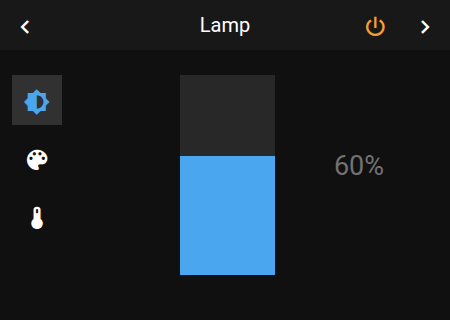
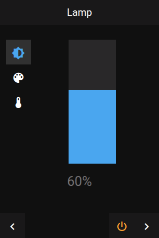

# Panel Light

 

## About

The light panel controls one light: power, brightness, color temperature, color and effects. It only shows the controls the light supports.

## How to configure

| Option | Default | Description |
|--------|---------|-------------|
| **Item** | — | The light to control. You can leave it empty and set it later; until then the panel shows no controls. |
| **Show Kelvin** | On | Show the color temperature in Kelvin (`3500K`). Off: in mireds (`286Mired`). This only changes what is shown. |

## Controls

| Control | Description | Shown when |
|---------|-------------|------------|
| **Power** | Turns the light on and off | Always, in the centre while no slider is open |
| **Brightness slider** | 0–100 % | The light supports brightness |
| **Color temperature slider** | Warm to cold white | The light supports color temperature |
| **Color wheel** | Tap or drag to pick a color | The light supports colors |
| **Function buttons** | Switch between brightness, color and color temperature. The effect button opens a list of the light's effects. | The light is on |

## How it behaves

- **Light off:** only the power button is shown.
- **A slider or the color wheel is open:** the power button moves to the header. Tap the active function button again to close the slider and get the centre power button back.
- **Title:** the item's name if you set one, otherwise the light's name.
- **Light unavailable:** the panel shows **Unavailable** and hides the controls.

## Popup

Tapping a light on another panel, for example a tile on a grid, opens the same controls as a popup (`popup_light`). The name set on that item is used as the popup's title.
