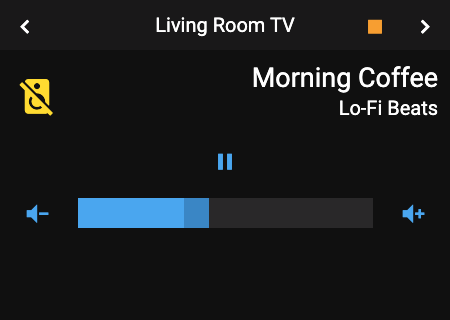
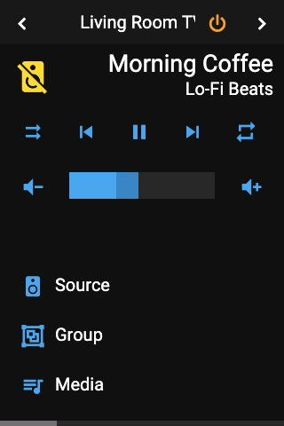

# Panel Media

 

## About

The media panel controls one media player, such as a TV, a speaker or a receiver. It shows the cover art, title and artist of what is playing, with buttons for playback, a volume slider on the right and a progress bar.

## How to configure

| Option | Description |
|--------|-------------|
| **Item** | The media player to control. You can leave it empty and set it later; until then the panel shows no controls. |
| **Sonos favorites** | A sensor that holds your Sonos favorites (from the Sonos integration). They appear under the **Media** button. |
| **Sonos favorites in source list** | Show the Sonos favorites in the source list instead. |
| **Media Favorites** | Your own favorites, one per row: a media content ID, or a `media_player` entity whose current media is played. |
| **Group media player entities** | More players that can be grouped with this one. |

## Controls

| Control | Shown when |
|---------|------------|
| **Play / pause, previous, next, shuffle, repeat** | The player supports them |
| **Volume slider** | Always. The volume is set when you release the slider. |
| **Progress bar** | A track with a known length is playing |
| **Source** button | The player has a source list, or the Sonos favorites are in the source list |
| **Media** button | You set media favorites, or Sonos favorites that are not in the source list |
| **Group** button | The player supports grouping (for example Sonos) and another player is available |

The players offered for grouping are the ones the player itself reports, plus those in **Group media player entities**.

## How it behaves

- **Nothing playing:** title and artist are empty. The header shows the channel name if the player reports one, otherwise the player's name.
- **Player unavailable:** the panel shows **Unavailable** and hides the controls.
- Names that are too long for a button or a list row are cut and end in `..`.

## Popup

Tapping a media player on another panel opens the same controls as a popup (`popup_media_player`).
