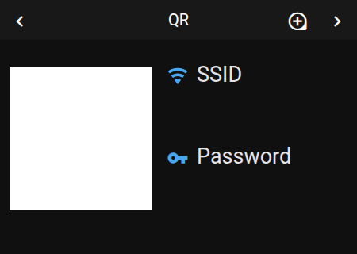
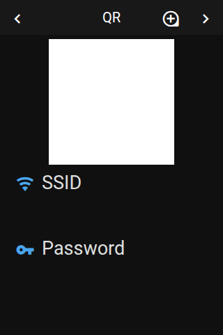

# Panel QR-Code

 

## About

The QR code panel shows a QR code that guests scan to join your Wi-Fi. It has two sizes: a large code on its own, or a smaller code with the network name and password beside it.

## How to configure

| Option | Default | Description |
|--------|---------|-------------|
| **WiFi SSID** | | The name of the Wi-Fi network. |
| **WiFi password** | | The password of the network. |
| **Show big code** | Off | Open the panel with the large code. |
| **Show network info** | On | Show the network name and password as text beside the small code. |
| **Text items** | — | Up to 2 entities whose values are shown beside the small code. They replace the network name and password. |

The QR code is built from the name and the password in the standard Wi-Fi format:

```
WIFI:S:<SSID>;T:WPA;P:<PASSWORD>;;
```

## How it behaves

- **Tap the code** to switch between the large and the small size. The zoom button in the header does the same.
- **The display stays on** while the large code is shown after a tap on the code: it does not dim and the idle page does not open, so guests have time to scan it. The zoom button in the header changes the size without keeping the display on.
- An item value longer than 19 characters continues on a second line.
