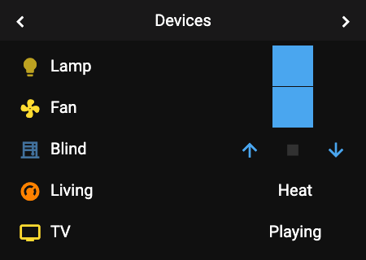
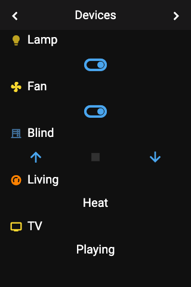

# Panel Row

 

## About

The row panel shows your entities as rows, five per page. Each row has an icon, a name and a control that fits the entity. It is a good choice for simple switches, sensors and quick actions.

## How to configure

Add the entities you want as **items**. For each item you can change the name, icon and color, see [Item Configuration](../configuration/items.md).

## Controls

The control of a row depends on the entity type:

| Entity type | Control |
|-------------|---------|
| `cover` | Open, stop and close buttons. Stop is only active while the cover moves. |
| `number`, `input_number` | A slider. Releasing it sets the value. |
| `switch`, `input_boolean`, `automation`, `light` | A toggle |
| `button`, `input_button`, `scene`, `script`, `lock`, `vacuum` | A button |
| Everything else, including `timer` | The value as text |

## How it behaves

- **More than 5 items:** a next-page button appears in the header.
- The panel remembers the page you were on and opens it again next time.
- A name or value that is too long is cut and ends in `..`.
- While a `number` entity is unavailable, its state is shown next to the slider instead of a value.
- Old values can be marked: with the device setting [`stale_data_seconds`](../configuration/device.md#general-settings), a value that has not updated for a while is dimmed and ends in `…`.
