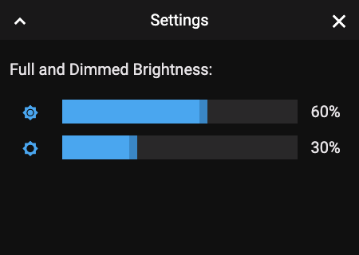
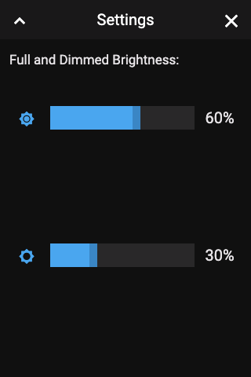

# Panel Settings

 

The Settings panel lets you change the brightness on the panel itself:

- the brightness when the display is on
- the brightness when the display is dimmed

Swipe down from the top edge of the screen to open it. The sliders apply when you release them.

All other settings are in the editor, see [Device Settings](../editor/device.md).

This is a built-in panel. You cannot add or change it.
