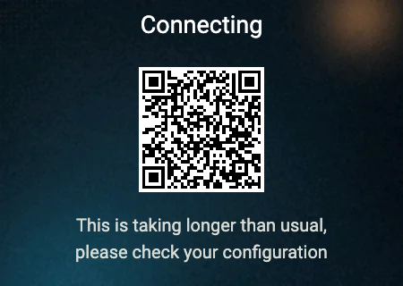
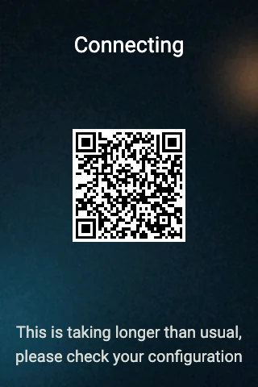

# Panel System

 

The System panel is what you see while the panel is not ready:

- **On the first start** it shows a QR code that leads to this documentation.
- **Without a connection to Home Assistant** it shows a message, in the language of the device.

This is a built-in panel. You cannot add or change it.
