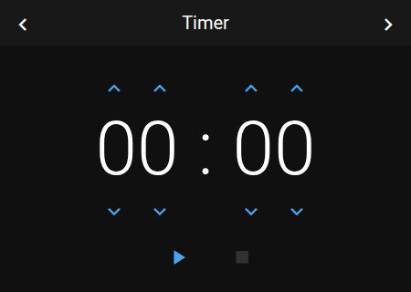
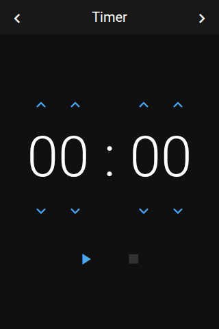

# Panel Timer

 

## About

The timer panel is a countdown timer and a stopwatch. It needs no Home Assistant entity, and it keeps running while you look at other panels.

- **Countdown:** set a time and start. The timer counts down to 00:00.
- **Stopwatch:** start at 00:00. The timer counts up.

## How to configure

| Option | Default | Description |
|--------|---------|-------------|
| **Show notification on finish** | Off | Show a notification popup when the countdown ends. |

When the countdown ends, the alert sound plays if the device setting `sound_on_notification` is on.

## Controls

| Control | Description |
|---------|-------------|
| **Time** | Minutes and seconds (`MM:SS`) in large digits |
| **Up / down arrows** | Set each of the four digits before you start |
| **Start** | Starts the timer. While it runs, the button pauses; while paused, it continues. |
| **Stop** | Stops the running timer. Pressed again while the timer is stopped, it sets the time back to 00:00. Inactive at 00:00. |
| **Stop in the header** | Stops the timer. Shown only while the timer runs. |

## How it behaves

- The timer runs in Home Assistant, not on the display. It keeps running when the display restarts, but it is lost when Home Assistant or the integration restarts.

## Popup

The timer can also open as a popup (`popup_timer`) on top of another panel. Because the timer has no entity, open it from an item: set the item's `popup_key` to `popup_timer`, or add a `navigate` item with `popup_timer`. See [Item Configuration](../configuration/items.md#override-a-default-popup).
