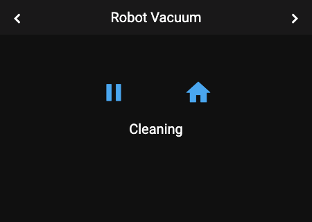
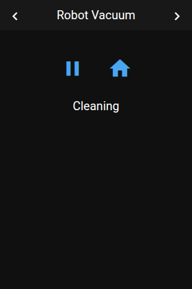

# Panel Vacuum

 

## About

The vacuum panel controls one robot vacuum: start and stop, return to the dock, fan speed and locate. Below the controls you can show up to 6 more entities, for example the filter state.

## How to configure

| Option | Description |
|--------|-------------|
| **Item** | The vacuum to control. You can leave it empty and set it later; until then the panel shows no controls. |
| **Battery Sensor** | A sensor with the battery level. Needed for the battery icon, because vacuum entities in Home Assistant no longer report the battery themselves. |
| **Secondary Items** | Up to 6 entities shown as buttons below the controls, for example sensors or switches. |

## Controls

| Control | Description | Shown when |
|---------|-------------|------------|
| **Action button** | Starts or continues cleaning. While cleaning, it pauses (or stops, if the vacuum cannot pause). The icon changes with the state. | Always |
| **Home button** | Sends the vacuum back to its dock. Inactive while it is docked. | The vacuum supports it |
| **Fan button** | Opens a list of fan speeds | The vacuum supports fan speeds |
| **Locate button** | Makes the vacuum play a sound | The vacuum supports it |
| **Status** | The state, for example "Cleaning", "Docked" or "Returning" | Always |
| **Battery icon** | The battery level in the header | A battery sensor is set |

## How it behaves

- **Title:** the vacuum's name.
- **Vacuum unavailable:** the panel shows **Unavailable**. The battery icon and the secondary items keep working.
- **Battery icon:** it uses the sensor's own icon if it has one, otherwise an icon for the level in steps of 10 %.

## Popup

Tapping a vacuum on another panel opens the same controls as a popup (`popup_vacuum`).
