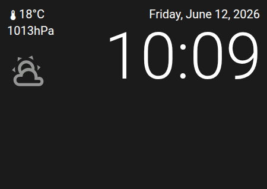
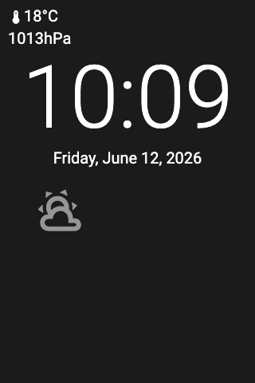

# Panel Weather

 

## About

The weather panel shows the current weather, a forecast and the time and date. It works well as a screensaver. Below the weather you can show up to two more values, for example the indoor temperature and humidity.

## How to configure

| Option | Description |
|--------|-------------|
| **Item** | The weather entity. Required. |
| **Info items** | Up to 2 entities shown below the weather, for example indoor temperature, humidity or CO2. |
| **Background** | A picture or **Use color scheme**, see [Background](#background). |
| **Show forecast** | **Daily** or **Hourly**. |
| **Show weather** | Show the large weather icon. |
| **Show temperature** | Show the temperature. |
| **Show home temperature** | Show the inside temperature next to the weather. |
| **Inside temperature sensor** | The sensor for the inside temperature. Empty: the NSPanel's built-in temperature sensor. |
| **Weather icon color** | **Color** (default) colors the icons by condition, **Monochrome** uses the text color. |
| **Show notifications** | Use the weather icon as the notification bell, see [Notifications](#notifications). |

### Cycle Cards

The time area can switch between several cards: the time, the date, temperatures and values of your entities. Only the time card is on by default, so nothing changes until you turn on another card.

| Option | Default | Description |
|--------|---------|-------------|
| **Show time** | On | The time with the date |
| **Show date** | Off | A separate date card: weekday and day (for example "Mon 16") with the full date |
| **Show outside temperature** | Off | The temperature of the weather entity |
| **Show inside temperature** | Off | The inside temperature, from the **Inside temperature sensor** |
| **Card entities** | — | Up to 4 entities as extra cards: the value in large letters, with the entity's name |
| **Seconds per card** | 5 | How long each card is shown |
| **First card pause** | 15 | How long the first card stays after a full round, in seconds |

The cards work as on the [clock panel](panel_clock.md#cycle-cards), with one difference: on the weather panel you cannot tap the time area to skip to the next card.

### Background

Choose a picture, or **Use color scheme** for a plain background from the selected theme. Text and icons always use colors that are readable on the chosen background.

For a background that changes, for example at night, choose **Template…**. See [Background pages](../configuration/device.md#background-pages) for all backgrounds and an example.

### Forecast

The forecast shows up to 5 entries. If the weather entity provides fewer, the remaining places stay empty. If a forecast update fails, the panel keeps showing the last forecast it received.

### Notifications

With **Show notifications** on, the weather icon turns into a bell while notifications are waiting:

- It blinks while there are new notifications.
- It stays visible without blinking when you have seen them but not dismissed them.
- Tap it to open the notifications.

### Leaving the Panel

This panel has no header buttons. To leave it:

- Swipe left or right from a screen edge to change the panel.
- Or turn on **Long press to go back** in the *Advanced* section. Then holding a finger anywhere for about a second goes back to the previous panel, or to the home panel. See [Standard Fields](../configuration/panels.md#standard-fields).
