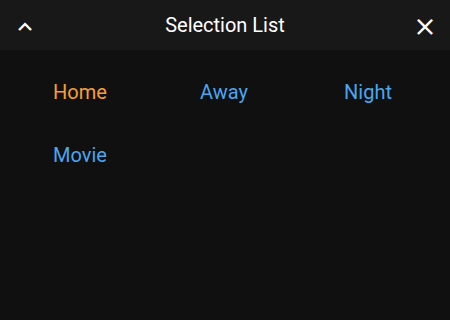
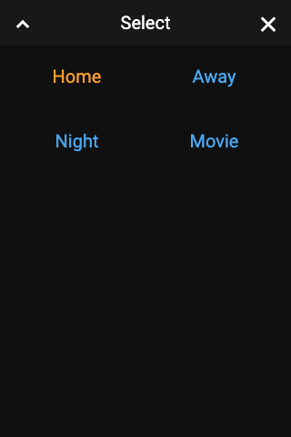

# Popup Select

 

## About

The select popup lets you choose a value from a list. Panels open it when there is something to choose, for example a fan speed, a mode, a preset or a light effect.

## How it behaves

- **Tap an entry** to select it. The popup closes and the choice is applied.
- **Several choices:** in lists that allow more than one choice, a tap turns an entry on or off.
- **Long lists:** a button in the header opens the next page.

## How to configure

You do not add this popup; the integration opens it. To change its title for a device, use **Add panel → Extend a popup**, see [System Panel Overrides](../editor/panels.md#system-panel-overrides).

## For developers

The popup can also be opened from code with your own entries and callbacks. See [Hub → Popup parameters](../../develop/hub.md#popup-parameters).
